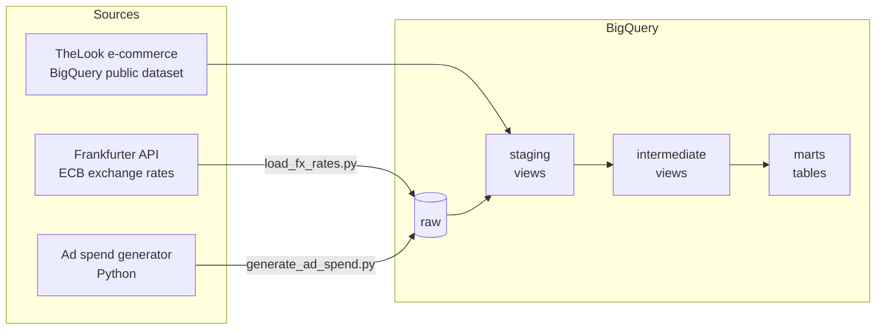

# E-commerce analytics pipeline

An analytics platform for an online clothing store, covering **sales, marketing, customers, website behaviour, operations and inventory**. Raw data is loaded with Python, modelled and tested with **dbt on BigQuery** using dimensional modelling, and delivered as marts that business teams can use directly.

## What it answers

| Domain | Key metrics |
|---|---|
| Sales | net revenue, orders, average order value, gross margin, return rate |
| Marketing | ad spend in USD, ROAS and CAC per channel, new customers |
| Customers | active and new customers, lifetime value, repeat purchase rate |
| Website | sessions, bounce rate, add-to-cart and conversion rates |
| Operations | days to ship and deliver, share shipped within 2 days |
| Inventory | units and value in stock, days in inventory, aged stock |

Every metric's definition and the design of every mart (inputs, grain, keys, measures) are in the [pipeline map](docs/pipeline-map.md).

### Example results

**Sales by year** (from `fct_orders`; 2026 up to mid-November)

| Year | Orders | Net revenue (USD) | Avg. order value (USD) | Gross margin | Return rate |
|---|---|---|---|---|---|
| 2022 | 9,223 | 600,966 | 65 | 51.8% | 11.0% |
| 2023 | 13,174 | 838,002 | 64 | 51.8% | 11.6% |
| 2024 | 18,846 | 1,206,596 | 64 | 51.9% | 11.9% |
| 2025 | 27,530 | 1,790,521 | 65 | 51.9% | 11.8% |
| 2026 | 46,051 | 2,993,666 | 65 | 51.9% | 11.7% |

**Marketing performance by channel**, January 2024 to November 2026 (from `mart_marketing_performance`)

| Channel | Ad spend (USD) | Net revenue (USD) | New customers | ROAS | CAC (USD) |
|---|---|---|---|---|---|
| Email | 29,545 | 279,357 | 2,338 | 9.46 | 12.64 |
| Search | 1,069,582 | 4,090,328 | 33,684 | 3.82 | 31.75 |
| Facebook | 145,853 | 341,777 | 2,909 | 2.34 | 50.14 |
| Display | 124,873 | 241,333 | 1,975 | 1.93 | 63.23 |
| Organic | 0 | 855,185 | 7,098 | – | – |

TheLook data is synthetic and ad spend is generated (see [Data sources](#data-sources)), so the numbers show that the pipeline works, not real business performance.

## Architecture



- **Ingestion:** Python scripts load exchange rates and ad spend into a `raw` dataset. TheLook is read directly from Google's public dataset.
- **Transformation:** dbt in three layers: **staging** (one view per source table: renaming, types, cleaning), **intermediate** (reusable logic such as daily exchange rates) and **marts** (tested fact and dimension tables for analysis).
- **Environments:** separate BigQuery datasets for development and production.

## Tech stack

| Tool | Used for |
|---|---|
| BigQuery | data warehouse |
| dbt Core 1.12, dbt_utils | transformation, tests, documentation |
| Python | ingestion (requests, google-cloud-bigquery) |
| Jira | sprint planning |
| Claude Code | AI pair programming and pull request reviews |

## Data model

13 dbt models and 65 data tests.

| Mart | Type | Grain | Used by |
|---|---|---|---|
| `fct_orders` | fact | one row per order | Sales, Marketing, Customers |
| `fct_ad_spend` | fact | one row per day and paid channel | Marketing |
| `dim_customers` | dimension | one row per customer | all domains |
| `mart_marketing_performance` | aggregated mart | one row per day and channel | Marketing |

Further marts in the design: `fct_order_items` (operations), `fct_sessions` (website), `fct_inventory_items` (inventory), `dim_products` and `dim_distribution_centers`.

**Shared facts and dimensions:** a few core tables serve every domain. `fct_orders` answers sales, marketing and customer questions, and `dim_customers` gives every domain the same sign-up channel and first order date. Only marketing has an aggregated mart, because it combines two facts with different grains (spend per day, revenue per order).

## Design decisions

**Modelling**
- **Design marts first.** Each domain starts from its KPIs, then the marts, then the models feeding them, so every model has a consumer.
- **Marts store measures, not ratios.** ROAS, CAC, average order value and margin % are calculated from summed measures, so they're correct for any period. Averaging daily ratios gives wrong totals.
- **Aggregate before joining facts with different grains.** Spend and revenue are summed per day and channel separately, then joined, so nothing is counted twice.
- **Personal data stays in staging.** Columns such as names and emails are tagged `contains_pii` and never reach the marts.

**Money and dates**
- **Currency conversion in one macro.** `convert_to_usd` uses `safe_divide` and exact `NUMERIC` arithmetic; rounding happens only for display, so totals don't drift.
- **Exchange rates carried forward.** Rates exist for working days only; weekends and holidays use the most recent rate, flagged in the data.
- **All dates in UTC**, in Python and SQL.

**Marketing logic**
- **First-touch attribution:** revenue belongs to the channel a customer signed up through. A new customer is one whose first non-cancelled order falls in the period.
- **Known limitation, calendar ROAS:** revenue in a period includes orders from customers acquired earlier, so it overstates the return on that period's spend. New-customer and cohort ROAS are on the roadmap.

## Data quality

- **Keys:** `unique` and `not_null` on every primary key; `unique_combination_of_columns` on composite grains
- **Relationships:** orders, order items and events point to existing customers and products
- **Source freshness:** warns when raw tables are more than 2 days old, errors after 4
- **Business rules:** net revenue never exceeds gross revenue; exchange rates are above 0; first orders don't predate sign-up
- **Severity policy:** unexpected category values warn (a source can add new values); broken keys and relationships fail the build

## Data sources

| Source | What | Notes |
|---|---|---|
| [TheLook e-commerce](https://console.cloud.google.com/marketplace/product/bigquery-public-data/thelook-ecommerce) | orders, order items, products, users, web events, inventory, distribution centers | synthetic public dataset, refreshed daily by Google |
| [Frankfurter API](https://frankfurter.dev) | daily USD to EUR and GBP rates | European Central Bank reference rates |
| `ingestion/generate_ad_spend.py` | daily ad spend per channel, billed in USD, EUR or GBP | synthetic, fixed random seed, budgets tuned to a realistic ROAS per channel |

## How to run it

**Prerequisites:** Python 3.11 or later, a Google Cloud project with BigQuery, and a service account with the BigQuery Data Editor and BigQuery Job User roles.

1. Clone the repo and install the dependencies:
   ```bash
   python -m venv .venv
   .venv\Scripts\activate          # macOS/Linux: source .venv/bin/activate
   pip install -r requirements.txt
   ```
2. Configure your own project:
   - set the environment variable `DBT_GOOGLE_KEYFILE` to the path of your service account key
   - replace the GCP project ID in `dbt/profiles.yml` and in the two ingestion scripts
   - create the datasets `raw`, `dbt_dev` and `dbt_prod` in BigQuery, in the US region (like TheLook)
3. Load the raw data:
   ```bash
   python ingestion/load_fx_rates.py
   python ingestion/generate_ad_spend.py
   ```
4. Build and test:
   ```bash
   cd dbt
   dbt deps
   dbt source freshness
   dbt build
   ```
5. Explore the documentation and lineage:
   ```bash
   dbt docs generate
   dbt docs serve
   ```

## Roadmap

- [x] Ingestion: exchange rates and ad spend
- [x] Staging models for all sources, with tests and source freshness
- [x] Sales: `fct_orders`
- [x] Marketing: `fct_ad_spend`, `dim_customers`, `mart_marketing_performance`
- [x] Pipeline map: KPIs, mart designs and lineage for all domains
- [ ] CI with GitHub Actions: build, test and lint (SQLFluff) every pull request; Slim CI
- [ ] Orchestration with Dagster: ingestion and dbt as assets, daily schedule
- [ ] Semantic layer with MetricFlow (ROAS, CAC)
- [ ] Customers: user snapshot, incremental `fct_orders` with a model contract, lifetime value
- [ ] Website, operations and inventory
- [ ] Looker Studio dashboard and dbt docs on GitHub Pages
