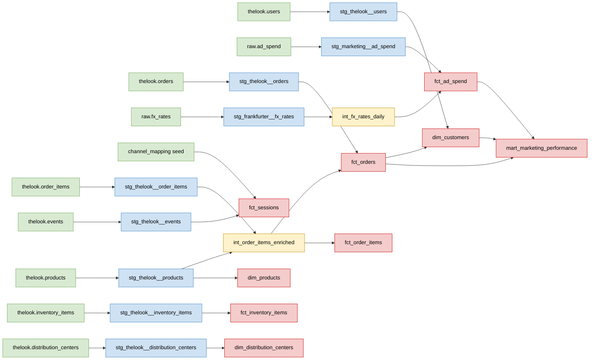

# Pipeline map

## 1. Business KPIs

### Sales
- Net revenue: money from orders, minus cancelled and returned items
- Number of orders: how many orders were placed
- AOV (average order value): net revenue ÷ number of orders
- Gross margin %: (net revenue − product cost) ÷ net revenue
- Return rate: % of items sold that were returned

### Marketing
- Ad spend: money spent on ads, converted to USD
- ROAS: net revenue ÷ ad spend (4 = $4 back per $1 spent)
- CAC: ad spend ÷ new customers
- New customers: customers who placed their first order in the period

### Customers
- Active customers: customers who placed at least one order in the period
- New vs returning customers: active customers split by whether this period has their first order
- LTV (lifetime value): total net revenue per customer since their first order
- Repeat purchase rate: % of customers with 2 or more orders

### Website
- Sessions: number of website visits
- Bounce rate: % of sessions with only 1 event
- Add-to-cart rate: % of sessions with at least one cart event
- Conversion rate: % of sessions with a purchase event

### Operations
- Days to ship: days from order placed to shipped
- Days to deliver: days from shipped to delivered
- Total delivery time: days from order placed to delivered
- % shipped within 2 days: share of shipped items that left within 2 days of the order (internal target; TheLook has no promised dates)

### Inventory
- Units in stock: stock items not sold yet
- Stock value: product cost of the units in stock
- Days in inventory: days from arriving in stock to being sold
- Aged stock: units in stock for more than 90 days

## 2. Marts

### Sales
1. Mart: fct_orders
    - Inputs: stg_thelook__orders, int_order_items_enriched
    - Grain: one row per order (order_id)
    - Primary key: order_id
    - Dimensions: order_date, order_status, user_id (join to dim_customers later for country, age, channel)
    - Measures: net_revenue, gross_revenue, net_margin, item_count, cancelled_item_count, returned_item_count
    - KPIs from the measures:
        - Net revenue = sum(net_revenue)
        - Number of orders = count(order_id)
        - AOV = sum(net_revenue) ÷ count(order_id)
        - Gross margin % = sum(net_margin) ÷ sum(net_revenue)
        - Return rate = sum(returned_item_count) ÷ (sum(item_count) − sum(cancelled_item_count))
    - Users: Head of Sales, Finance
    - Refresh: daily, full rebuild as a table (incremental later)

Also used by Sales: fct_order_items (see Operations) for revenue, margin and returns by product, category or brand.

### Marketing
1. Mart: fct_ad_spend
    - Inputs: stg_marketing__ad_spend, int_fx_rates_daily
    - Grain: one row per day per paid channel (spend_date × channel)
    - Primary key: spend_date + channel (tested with dbt_utils.unique_combination_of_columns)
    - Dimensions: spend_date, channel, currency
    - Measures:
        - spend_usd: spend converted to USD with convert_to_usd (sum this one)
        - spend: spend in the original currency (only sum within one currency)
        - rate: FX rate used for the conversion, kept so spend_usd can be checked
    - Users: Head of Marketing (daily spend trends), input to mart_marketing_performance
    - Refresh: daily after the ad spend and FX rate loads, full rebuild as a table

2. Mart: mart_marketing_performance
    - Inputs: fct_ad_spend, fct_orders, dim_customers (sign-up channel, first order date)
    - Grain: one row per day per channel (date × channel), for the days that have ad spend data
    - Primary key: date + channel (tested with dbt_utils.unique_combination_of_columns)
    - Dimensions: date, channel (includes organic, which has revenue but no spend)
    - Measures (all additive, so Looker can roll them up to any period):
        - spend_usd: ad spend in USD that day (0 for organic)
        - net_revenue: net revenue of orders placed that day by customers who signed up through the channel
        - orders: number of those orders (cancelled orders excluded)
        - new_customers: customers whose first order was that day
    - KPIs, calculated in Looker from the sums (never stored or averaged per day):
        - Ad spend = sum(spend_usd)
        - ROAS = sum(net_revenue) ÷ sum(spend_usd) (empty for organic)
        - CAC = sum(spend_usd) ÷ sum(new_customers) (empty for organic)
        - New customers = sum(new_customers)
    - Limitation: calendar ROAS. Revenue includes orders from customers acquired before the period, so it overstates the return on that period's spend (new-customer ROAS in DATA-57).
    - Users: Head of Marketing (budget per channel)
    - Refresh: daily after fct_ad_spend, fct_orders and dim_customers, full rebuild as a table

### Customers
No mart of its own. The KPIs come from dim_customers and fct_orders:
- Active customers = count(distinct user_id) in fct_orders per period
- New vs returning customers = active customers split by fct_orders.is_first_order (column to add)
- LTV = dim_customers.lifetime_net_revenue
- Repeat purchase rate = customers with order_count ≥ 2 ÷ customers with order_count ≥ 1

Optional later: mart_customer_ltv for cohort LTV (revenue per sign-up month after 3, 6 and 12 months).

### Website
1. Mart: fct_sessions
    - Inputs: stg_thelook__events, channel_mapping (seed, DATA-20)
    - Grain: one row per session (session_id)
    - Primary key: session_id
    - Dimensions: session_date, channel (mapped from the event traffic_source), user_id (empty for visitors who are not signed in)
    - Measures and flags:
        - event_count: number of events in the session
        - is_bounce: only 1 event
        - has_product_view, has_cart, has_purchase: reached each funnel step
    - KPIs from the measures:
        - Sessions = count(session_id)
        - Bounce rate = count(is_bounce) ÷ sessions
        - Add-to-cart rate = count(has_cart) ÷ sessions
        - Conversion rate = count(has_purchase) ÷ sessions
    - Users: Head of E-commerce (funnel), Marketing (which channels bring visits that convert)
    - Refresh: daily, incremental later (events is the biggest table)

Optional later: fct_events (one row per event) for path questions, such as which page visitors leave from.

### Operations
1. Mart: fct_order_items
    - Inputs: int_order_items_enriched
    - Grain: one row per order item (order_item_id)
    - Primary key: order_item_id
    - Dimensions: order_date, item_status, order_id, user_id, product_id (join to dim_products), distribution_center_id (join to dim_distribution_centers)
    - Measures and flags:
        - Fulfilment: days_to_ship, days_to_deliver, days_order_to_delivery, is_shipped_within_2_days
        - Sales: sale_price, product_cost, item_margin, is_cancelled, is_returned
    - KPIs from the measures:
        - Days to ship = avg(days_to_ship) for shipped items
        - Days to deliver = avg(days_to_deliver) for delivered items
        - Total delivery time = avg(days_order_to_delivery) for delivered items
        - % shipped within 2 days = count(is_shipped_within_2_days) ÷ shipped items
    - Users: Head of Operations (fulfilment by distribution center), Head of Sales (product performance)
    - Refresh: daily, incremental (DATA-25)

### Inventory
1. Mart: fct_inventory_items
    - Inputs: stg_thelook__inventory_items (new source and staging model)
    - Grain: one row per stock item (inventory_item_id)
    - Primary key: inventory_item_id
    - Dimensions: received_date, sold_date (empty if not sold), product_id (join to dim_products), distribution_center_id (join to dim_distribution_centers)
    - Measures and flags:
        - product_cost
        - is_in_stock: not sold yet
        - days_in_inventory: days from received to sold (empty if not sold)
        - days_in_stock_so_far: days since received, for unsold items
    - KPIs from the measures:
        - Units in stock = count(is_in_stock)
        - Stock value = sum(product_cost) where is_in_stock
        - Days in inventory = avg(days_in_inventory)
        - Aged stock = count(is_in_stock and days_in_stock_so_far > 90)
    - Users: Head of Merchandising / Buying
    - Refresh: daily, incremental later (large table)

### Shared dimensions
1. Dim: dim_customers
    - Inputs: stg_thelook__users, fct_orders
    - Grain: one row per customer (user_id)
    - Primary key: user_id
    - Attributes:
        - From users: channel (sign-up traffic_source), signed_up_at, country, age, gender
        - From orders: first_order_date, last_order_date, order_count, lifetime_net_revenue
        - No personal data (names, email, address stay in staging)
    - Users: everyone (Sales by country, Marketing by channel, Customers for LTV)
    - Refresh: daily after fct_orders, full rebuild as a table

2. Dim: dim_products
    - Inputs: stg_thelook__products
    - Grain: one row per product (product_id)
    - Primary key: product_id
    - Attributes: product_name, brand, category, department, retail_price, product_cost, distribution_center_id
    - Users: Sales (by category and brand), Inventory
    - Refresh: daily, full rebuild as a table

3. Dim: dim_distribution_centers
    - Inputs: stg_thelook__distribution_centers (new source and staging model)
    - Grain: one row per distribution center (distribution_center_id)
    - Primary key: distribution_center_id
    - Attributes: name, latitude, longitude
    - Users: Operations, Inventory
    - Refresh: daily, full rebuild as a table

## 3. Lineage

Target design: all sources and models, built and planned.

